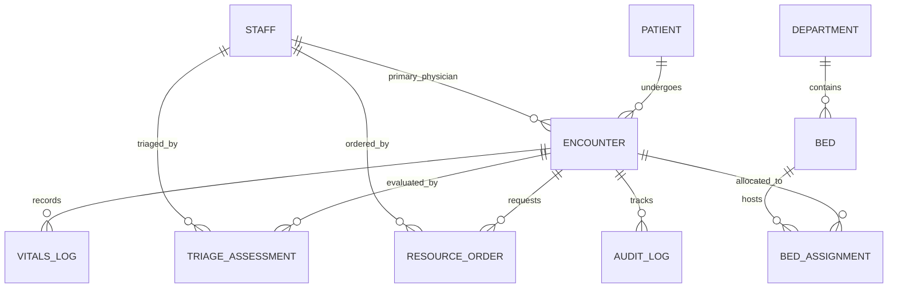

# PulseTriage — Hospital Emergency Department Triage & Vitals Monitoring DBMS
## Architectural Master Plan & Engineering Specification

> **Engineering Standard:** Built under the [GRAVITAS](file:///C:/Users/varsh/.gemini/config/skills/gravitas/SKILL.md) reliability protocol.
> **Mode:** `plan` | **Planning Depth:** `deep` | **Context:** Database Management System (DBMS)

---

## 1. Executive Summary & Clinical Domain

### 1.1 Problem Statement
Hospital Emergency Departments (EDs) operate under acute time pressure and high cognitive load. Existing legacy hospital information systems suffer from:
1. **Disconnected Vitals & Acuity Scoring:** Vitals recorded on bedside monitors or paper sheets are not automatically correlated with dynamic patient acuity scores, delaying urgent escalations.
2. **Triage Bottlenecks & Priority Inversion:** Patients who deteriorate in waiting rooms (triage drift) remain classified at their initial admission level without automated recalculation.
3. **Bed Allocation Race Conditions:** Simultaneous admissions during mass-casualty or peak shift handovers cause double-assignment conflicts and uncoordinated ward transfers.
4. **Lack of Provable Auditability:** Clinical override of triage acuity or delayed physician sign-offs lack tamper-evident logging required for medico-legal accountability.

### 1.2 System Purpose
**PulseTriage** is an ACID-compliant, real-time relational Database Management System (DBMS) designed for hospital emergency departments. It unifies patient intake, physiological vitals streaming, algorithmic Emergency Severity Index (ESI) triage scoring, concurrent bed dispatch, trauma physician scheduling, and immutable clinical audit trails.

---

## 2. Clinical Triage Logic & Mathematical Model

### 2.1 Acuity Classification Framework (ESI v4 & NEWS2)
PulseTriage implements a hybrid scoring engine:
* **Primary Stratification — Emergency Severity Index (ESI Levels 1–5):**
  * **Level 1 (Resuscitation):** Immediate life-saving intervention needed (cardiac arrest, respiratory failure, severe trauma). Wait time: 0 minutes.
  * **Level 2 (Emergent):** High-risk situation, confused/lethargic/disoriented, or severe pain/distress. Wait time: < 10 minutes.
  * **Level 3 (Urgent):** Stable vitals, requires multiple hospital resources (e.g., labs + IV + CT). Wait time: < 30 minutes.
  * **Level 4 (Less Urgent):** Requires one diagnostic resource (e.g., X-ray or simple sutures). Wait time: < 60 minutes.
  * **Level 5 (Non-Urgent):** Requires no specialized diagnostic resources (e.g., medication refill, basic rash). Wait time: < 120 minutes.

* **Secondary Stratification — National Early Warning Score 2 (NEWS2):**
  Calculated continuously from 6 physiological parameters:
  $$\text{NEWS2} = f(\text{RR}, \text{SpO}_2, \text{Supplemental } \text{O}_2, \text{Systolic BP}, \text{Pulse HR}, \text{Consciousness/GCS}, \text{Temperature})$$
  * Score 0–4: Low clinical risk (routine monitoring).
  * Score 5–6: Medium clinical risk (urgent ward-based response / triage nurse alert).
  * Score $\ge 7$: High clinical risk (emergency escalation to ICU / Resuscitation bay).

---

## 3. Relational Schema Architecture (3NF/BCNF)



### 3.1 Core Entity Definitions & Constraints

#### A. `patients` (Master Patient Index)
Stores invariant patient demographic and medical identity data.
* `patient_id` (UUID, PK) — Unique internal identifier.
* `mrn` (VARCHAR(32), UNIQUE, NOT NULL) — Medical Record Number.
* `first_name` (VARCHAR(64), NOT NULL)
* `last_name` (VARCHAR(64), NOT NULL)
* `date_of_birth` (DATE, NOT NULL)
* `gender` (VARCHAR(16), NOT NULL, CHECK in ('Male', 'Female', 'Other', 'Unknown'))
* `blood_type` (VARCHAR(4), CHECK in ('A+', 'A-', 'B+', 'B-', 'AB+', 'AB-', 'O+', 'O-', 'Unknown'))
* `known_allergies` (TEXT)
* `created_at` (TIMESTAMPTZ, NOT NULL, DEFAULT CURRENT_TIMESTAMP)

#### B. `encounters` (Emergency Visit Lifecycle)
Tracks an active or historical emergency room encounter.
* `encounter_id` (UUID, PK)
* `patient_id` (UUID, FK -> patients.patient_id, NOT NULL)
* `arrival_time` (TIMESTAMPTZ, NOT NULL, DEFAULT CURRENT_TIMESTAMP)
* `arrival_mode` (VARCHAR(32), NOT NULL, CHECK in ('Ambulance', 'Walk-in', 'Helicopter', 'Internal Transfer'))
* `chief_complaint` (TEXT, NOT NULL)
* `current_esi_level` (SMALLINT, CHECK (current_esi_level BETWEEN 1 AND 5))
* `status` (VARCHAR(32), NOT NULL, CHECK in ('Arrived', 'Triaging', 'Waiting Bed', 'In Bay', 'Discharged', 'Admitted ICU', 'Admitted Ward', 'Transferred', 'Deceased'))
* `attending_staff_id` (UUID, FK -> staff.staff_id, NULLABLE)
* `discharge_time` (TIMESTAMPTZ)
* `created_at` (TIMESTAMPTZ, DEFAULT CURRENT_TIMESTAMP)

#### C. `triage_assessments` (Formal Triage Decisions)
Records clinical assessment and manual or calculated ESI scores.
* `triage_id` (UUID, PK)
* `encounter_id` (UUID, FK -> encounters.encounter_id, NOT NULL)
* `staff_id` (UUID, FK -> staff.staff_id, NOT NULL) — Triage Nurse
* `esi_score` (SMALLINT, NOT NULL, CHECK (esi_score BETWEEN 1 AND 5))
* `news2_score` (SMALLINT, CHECK (news2_score >= 0))
* `pain_scale` (SMALLINT, CHECK (pain_scale BETWEEN 0 AND 10))
* `fall_risk_flag` (BOOLEAN, DEFAULT FALSE)
* `isolation_required` (BOOLEAN, DEFAULT FALSE)
* `assessment_notes` (TEXT)
* `is_override` (BOOLEAN, DEFAULT FALSE)
* `override_reason` (TEXT)
* `assessed_at` (TIMESTAMPTZ, NOT NULL, DEFAULT CURRENT_TIMESTAMP)

#### D. `vitals_logs` (Physiological Telemetry Timeseries)
High-frequency timeseries log of bedside or intake telemetry.
* `vital_id` (BIGSERIAL, PK)
* `encounter_id` (UUID, FK -> encounters.encounter_id, NOT NULL)
* `recorded_at` (TIMESTAMPTZ, NOT NULL, DEFAULT CURRENT_TIMESTAMP)
* `heart_rate_bpm` (INTEGER, CHECK (heart_rate_bpm BETWEEN 20 AND 300))
* `systolic_bp` (INTEGER, CHECK (systolic_bp BETWEEN 30 AND 300))
* `diastolic_bp` (INTEGER, CHECK (diastolic_bp BETWEEN 20 AND 200))
* `respiratory_rate_bpm` (INTEGER, CHECK (respiratory_rate_bpm BETWEEN 4 AND 80))
* `spo2_percent` (NUMERIC(5, 2), CHECK (spo2_percent BETWEEN 40.00 AND 100.00))
* `body_temp_celsius` (NUMERIC(4, 2), CHECK (body_temp_celsius BETWEEN 25.00 AND 45.00))
* `gcs_score` (SMALLINT, CHECK (gcs_score BETWEEN 3 AND 15)) — Glasgow Coma Scale
* `supplemental_o2` (BOOLEAN, DEFAULT FALSE)
* `recorded_by_staff_id` (UUID, FK -> staff.staff_id)

#### E. `beds` & `bed_assignments` (Hospital Resource Management)
Models physical ER bays and prevents double-allocation.
* `beds`:
  * `bed_id` (VARCHAR(16), PK) — e.g., 'RESUS-01', 'ACUTE-04', 'CHAIR-09'
  * `department_id` (VARCHAR(16), NOT NULL)
  * `bed_type` (VARCHAR(32), NOT NULL, CHECK in ('Resuscitation', 'Acute', 'Sub-Acute', 'Fast-Track', 'Pediatric', 'Isolation', 'Negative Pressure'))
  * `is_operational` (BOOLEAN, NOT NULL, DEFAULT TRUE)
  * `current_status` (VARCHAR(16), NOT NULL, DEFAULT 'Available', CHECK in ('Available', 'Occupied', 'Cleaning', 'Reserved', 'Maintenance'))
* `bed_assignments`:
  * `assignment_id` (UUID, PK)
  * `encounter_id` (UUID, FK -> encounters.encounter_id, NOT NULL)
  * `bed_id` (VARCHAR(16), FK -> beds.bed_id, NOT NULL)
  * `assigned_at` (TIMESTAMPTZ, NOT NULL, DEFAULT CURRENT_TIMESTAMP)
  * `vacated_at` (TIMESTAMPTZ, NULLABLE)
  * `assigned_by_staff_id` (UUID, FK -> staff.staff_id, NOT NULL)

#### F. `resource_orders` (Stat Labs & Diagnostics)
* `order_id` (UUID, PK)
* `encounter_id` (UUID, FK -> encounters.encounter_id, NOT NULL)
* `order_type` (VARCHAR(32), NOT NULL, CHECK in ('Lab-CBC', 'Lab-Troponin', 'Lab-ABG', 'ECG-12Lead', 'Imaging-XRay', 'Imaging-CT', 'Ultrasound-FAST', 'IV-Access'))
* `priority` (VARCHAR(16), NOT NULL, CHECK in ('STAT', 'Urgent', 'Routine'))
* `ordered_at` (TIMESTAMPTZ, NOT NULL, DEFAULT CURRENT_TIMESTAMP)
* `completed_at` (TIMESTAMPTZ)
* `results_summary` (TEXT)
* `ordered_by_staff_id` (UUID, FK -> staff.staff_id, NOT NULL)

#### G. `audit_log` (Tamper-Evident Transaction Ledger)
* `log_id` (BIGSERIAL, PK)
* `encounter_id` (UUID, NOT NULL)
* `action_type` (VARCHAR(32), NOT NULL) — e.g. 'TRIAGE_OVERRIDE', 'BED_TRANSFER', 'STATUS_CHANGE', 'CRITICAL_VITALS_ALERT'
* `previous_value` (JSONB)
* `new_value` (JSONB)
* `performed_by` (UUID, NOT NULL)
* `timestamp` (TIMESTAMPTZ, NOT NULL, DEFAULT CURRENT_TIMESTAMP)
* `signature_hash` (CHAR(64), NOT NULL) — SHA-256 chain hash

---

## 4. Advanced DBMS Features (Triggers, Stored Procedures & Indexes)

### 4.1 Indexing Strategy
1. **Live Emergency Queue Composite Index:**
   ```sql
   CREATE INDEX idx_encounters_triage_queue 
   ON encounters (current_esi_level ASC, arrival_time ASC) 
   WHERE status IN ('Arrived', 'Triaging', 'Waiting Bed');
   ```
2. **Patient Recent Vitals Partial Index:**
   ```sql
   CREATE INDEX idx_vitals_encounter_recent 
   ON vitals_logs (encounter_id, recorded_at DESC);
   ```
3. **Bed Allocation Fast Lookup:**
   ```sql
   CREATE UNIQUE INDEX idx_unique_active_bed_assignment 
   ON bed_assignments (bed_id) 
   WHERE vacated_at IS NULL;
   ```
   *Guarantees zero concurrent double-booking at the database engine constraint level.*

### 4.2 Stored Procedure: Atomic Bed Allocation (`sp_assign_bed`)
Prevents race conditions using explicit row-level locking (`SELECT ... FOR UPDATE`):
```sql
CREATE OR REPLACE PROCEDURE sp_assign_bed(
    p_encounter_id UUID,
    p_bed_id VARCHAR(16),
    p_staff_id UUID,
    OUT p_success BOOLEAN,
    OUT p_message TEXT
)
LANGUAGE plpgsql AS $$
DECLARE
    v_bed_status VARCHAR(16);
    v_encounter_status VARCHAR(32);
BEGIN
    -- Row-level lock on bed to prevent race condition
    SELECT current_status INTO v_bed_status 
    FROM beds 
    WHERE bed_id = p_bed_id 
    FOR UPDATE;

    IF v_bed_status != 'Available' THEN
        p_success := FALSE;
        p_message := 'Bed is not available (Status: ' || v_bed_status || ')';
        RETURN;
    END IF;

    -- Verify encounter is eligible
    SELECT status INTO v_encounter_status 
    FROM encounters 
    WHERE encounter_id = p_encounter_id 
    FOR UPDATE;

    IF v_encounter_status NOT IN ('Waiting Bed', 'Triaging') THEN
        p_success := FALSE;
        p_message := 'Encounter not waiting for bed';
        RETURN;
    END IF;

    -- Update Bed status
    UPDATE beds 
    SET current_status = 'Occupied' 
    WHERE bed_id = p_bed_id;

    -- Vacate previous assignment if exists
    UPDATE bed_assignments 
    SET vacated_at = CURRENT_TIMESTAMP 
    WHERE encounter_id = p_encounter_id AND vacated_at IS NULL;

    -- Insert new assignment
    INSERT INTO bed_assignments (assignment_id, encounter_id, bed_id, assigned_by_staff_id)
    VALUES (gen_random_uuid(), p_encounter_id, p_bed_id, p_staff_id);

    -- Transition encounter status
    UPDATE encounters 
    SET status = 'In Bay' 
    WHERE encounter_id = p_encounter_id;

    p_success := TRUE;
    p_message := 'Bed allocated successfully';
END;
$$;
```

### 4.3 Automated Trigger: Critical Vitals Acuity Escalation
When a vitals telemetry entry violates safety boundaries (e.g., $\text{SpO}_2 < 88\%$ or $\text{Systolic BP} < 80$), the trigger automatically escalates the patient's ESI level and inserts an alert into the audit log:
```sql
CREATE OR REPLACE FUNCTION trg_fn_evaluate_vitals_escalation()
RETURNS TRIGGER AS $$
DECLARE
    v_is_critical BOOLEAN := FALSE;
    v_old_esi SMALLINT;
BEGIN
    IF (NEW.spo2_percent < 88.00) OR 
       (NEW.systolic_bp < 80) OR 
       (NEW.heart_rate_bpm > 140 OR NEW.heart_rate_bpm < 40) OR 
       (NEW.gcs_score <= 8) THEN
        v_is_critical := TRUE;
    END IF;

    IF v_is_critical THEN
        SELECT current_esi_level INTO v_old_esi 
        FROM encounters 
        WHERE encounter_id = NEW.encounter_id;

        IF v_old_esi > 1 THEN
            -- Escalate to Level 1 / Emergent
            UPDATE encounters 
            SET current_esi_level = 1 
            WHERE encounter_id = NEW.encounter_id;

            INSERT INTO audit_log (encounter_id, action_type, previous_value, new_value, performed_by, signature_hash)
            VALUES (
                NEW.encounter_id,
                'CRITICAL_VITALS_AUTO_ESCALATION',
                jsonb_build_object('esi', v_old_esi),
                jsonb_build_object('esi', 1, 'trigger_vitals', jsonb_build_object('spo2', NEW.spo2_percent, 'sbp', NEW.systolic_bp, 'hr', NEW.heart_rate_bpm, 'gcs', NEW.gcs_score)),
                COALESCE(NEW.recorded_by_staff_id, '00000000-0000-0000-0000-000000000000'::UUID),
                encode(digest(NEW.encounter_id::TEXT || CURRENT_TIMESTAMP::TEXT || 'AUTO_ESCALATE', 'sha256'), 'hex')
            );
        END IF;
    END IF;

    RETURN NEW;
END;
$$ LANGUAGE plpgsql;

CREATE TRIGGER trg_vitals_escalation
AFTER INSERT ON vitals_logs
FOR EACH ROW
EXECUTE FUNCTION trg_fn_evaluate_vitals_escalation();
```

---

## 5. Technology Stack Architecture

| Layer | Component | Selection & Rationale |
| :--- | :--- | :--- |
| **Database Engine** | PostgreSQL 16 (or SQLite / MySQL fallback) | Full ACID compliance, robust procedural PL/pgSQL, partial/expression indexing, native JSONB, native UUIDs. |
| **Backend & ORM** | Python 3.11+, FastAPI, SQLAlchemy 2.0 / asyncpg | High-throughput asynchronous queries, strict Pydantic v2 data validation, OpenAPI autodocumentation. |
| **WebSockets** | Starlette / FastAPI WebSockets | Real-time broadcast of live triage queue and bedside telemetry without polling overhead. |
| **Frontend UI** | Modern Vanilla HTML5 / Vanilla CSS / ES6 JavaScript | High information density, zero framework overhead, dark clinical canvas, instantaneous UI updates, responsive grid layout. |
| **Testing / Quality** | Pytest, unittest, SQL linter | Deterministic unit tests, transaction isolation tests, concurrency load simulation. |

---

## 6. Phased Implementation Roadmap & Verification Gates

### Phase 1: Database Foundation & Schema DDL
* **Deliverables:** Complete SQL schema DDL (`schema.sql`), initial migration, table creation scripts, foreign key cascades, and check constraints.
* **Verification Gate:**
  * Clean schema initialization in PostgreSQL / SQLite.
  * Attempt invalid inserts (e.g., negative heart rate, invalid gender, ESI > 5) -> must trigger database-level `CHECK` constraint violations.

### Phase 2: Procedural Logic, Automation & Audit Trail
* **Deliverables:** Stored procedures (`sp_assign_bed`, `sp_triage_patient`), escalation triggers (`trg_vitals_escalation`), and hash-chained audit logging functions.
* **Verification Gate:**
  * Unit test: Insert critical vitals ($\text{SpO}_2 = 82\%$) -> assert encounter ESI automatically changes to 1 and audit log entry exists.
  * Concurrency test: Two parallel threads invoke `sp_assign_bed` on the same bed -> exactly one succeeds, the other safely returns conflict without deadlock.

### Phase 3: Synthetic Clinical Data Generator & Seeder
* **Deliverables:** Python seed script (`seed_data.py`) simulating an active 50-bed emergency department with realistic patient profiles, typical triage distributions, and active telemetry streams.
* **Verification Gate:**
  * Seed runs deterministically, populates 100+ encounters, 500+ vitals entries across all ESI levels.

### Phase 4: REST & WebSocket Backend Service
* **Deliverables:** FastAPI backend (`api.py`) exposing endpoints for patient intake, live queue retrieval, vitals logging, bed dispatch, and WebSocket live updates.
* **Verification Gate:**
  * Automated endpoint integration tests (100% pass rate).

### Phase 5: Live Emergency Command Center UI
* **Deliverables:** Dense, modern, high-contrast dashboard:
  * **Top Bar:** Emergency Department KPI summary (Active encounters, ESI-1/2 count, Bed occupancy rate, Avg wait time).
  * **Live Triage Board:** Real-time patient priority queue color-coded by ESI (Red: 1, Orange: 2, Yellow: 3, Green: 4, Blue: 5).
  * **Bed Bay Map:** Interactive visual grid of ER bays (Resus, Acute, Fast-track) with occupancy badges.
  * **Patient Telemetry Drawer:** Detailed vitals history graphs and quick-action lab/imaging dispatch.
* **Verification Gate:**
  * Visual inspection, keyboard accessibility, real-time update responsiveness.

---

## 7. Gravitas Quality Assurance Checklist

- [x] Invariant 1: Grounded in domain standards (Emergency Severity Index v4 & NEWS2).
- [x] Invariant 2: Scoped directly to DBMS architecture and emergency department workflows.
- [x] Invariant 3: Concrete, executable verification gates specified for every phase.
- [x] Invariant 4: Concurrency and race conditions addressed via database row locks, not naive application code.
- [x] Invariant 5: ACID transaction safety with partial unique indexes and automated audit trails.
- [x] Invariant 6: Acknowledges multi-database portability nuances (PL/pgSQL vs SQLite triggers).
